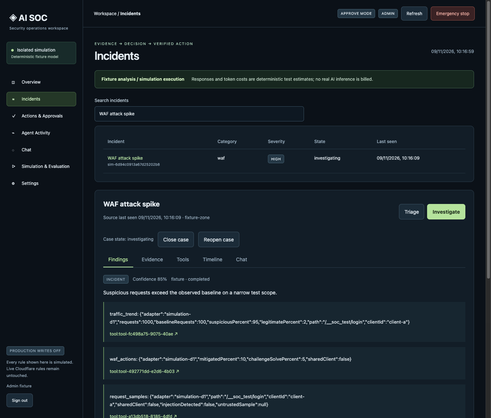
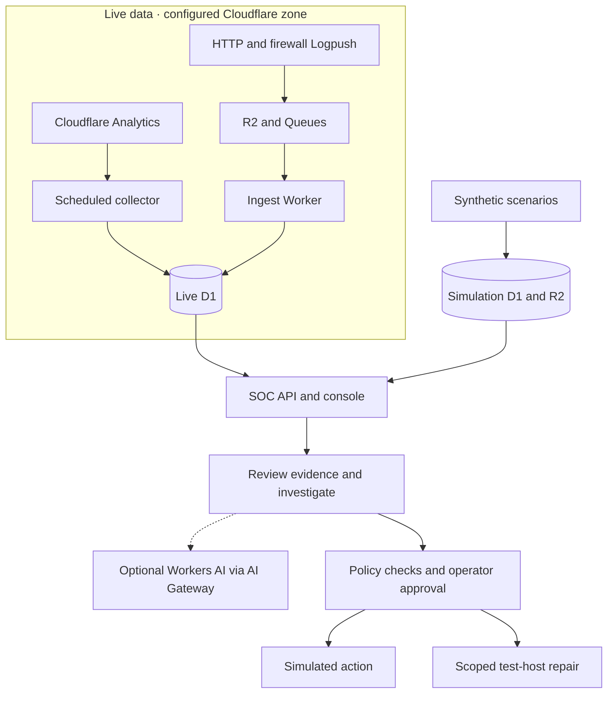

# Cloudflare AI SOC

Cloudflare AI SOC is a security operations console for Cloudflare zones. It helps operators understand what happened, inspect the evidence behind a finding, and decide whether a response is warranted. The local workbench lets you rehearse that workflow with synthetic incidents before configuring a live deployment.



_The local workbench investigating a synthetic WAF traffic spike. The findings and evidence shown come from the bundled scenario._

## What you can do

- **Monitor a zone.** Filter observations by priority, expand their evidence in place, and look for related HTTP or firewall records when Logpush is configured.
- **Investigate a finding.** Review the underlying evidence, see what the investigation concluded, and inspect its limitations. A configured live deployment can use Workers AI for investigations.
- **Rehearse a response.** Replay one of 12 scenarios, review a proposed action, and practice approval, verification, expiry, and rollback with the simulated executor. The optional Cloudflare repair path is scoped to a separately configured test hostname and requires operator approval.

## How it works



The local demo runs with a fixture model and requires no Cloudflare account. For a live deployment, see the [deployment configuration](docs/deployment-configuration.md).

## Run locally

Use Node.js 26 or newer and npm 11 or newer.

```sh
npm ci
npm run dev
```

1. Open the loopback address printed by the server and sign in with the **Admin fixture**.
2. Open **Simulation & Evaluation**. Find **WAF attack spike** and choose **Replay & investigate**.
3. Open **Incidents**, select **WAF attack spike**, and review **Findings**, **Evidence**, and **Tools**.

Use **Run all 12 scenarios** to exercise the full evaluation suite. The server keeps local state and generated fixture keys under the ignored `.local/` directory.

## Check the project

```sh
npm run check
```

This runs lint, TypeScript checks, offline Worker builds, integration tests and a source credential scan. Tests use local Miniflare storage and need permission to open loopback sockets. GitHub Actions runs the same checks on pushes and pull requests.

| Directory           | Contents                                                           |
| ------------------- | ------------------------------------------------------------------ |
| `apps/console`      | React console for Simulation and Live                              |
| `apps/api`          | Authenticated API, investigation policy and controlled test repair |
| `apps/ingest`       | Logpush and fixture ingestion, retention and recovery              |
| `apps/access-probe` | Cloudflare Access login verification probe                         |
| `packages/shared`   | Schemas and shared policy types                                    |
| `infrastructure`    | Migrations and synthetic seed data                                 |

The [design specification](cloudflare-ai-soc-master-spec.md) describes the original goals and acceptance criteria.
